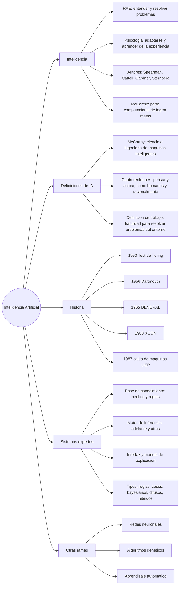

# Mapa mental: Inteligencia, IA y sistemas expertos

Este código sirve para generar la base del mapa mental en Excalidraw:

1. Abre https://excalidraw.com/
2. Menú de herramientas: **Más herramientas → Mermaid a Excalidraw** (también **Insertar → Mermaid**, según la versión).
3. Pega el código de abajo, inserta y acomoda los elementos.
4. Exporta el resultado como imagen o guarda el archivo `.excalidraw`, y súbelo al repositorio.

## Mismo contenido en forma de lista

- **Inteligencia artificial**
  - **Inteligencia**: RAE (entender y resolver problemas) · Psicología (adaptarse, aprender de la experiencia) · Autores (Spearman, Cattell, Gardner, Sternberg) · McCarthy (parte computacional de lograr metas).
  - **Definiciones de IA**: McCarthy · Cuatro enfoques de Russell y Norvig · Definición de trabajo del curso.
  - **Historia**: 1950 test de Turing · 1956 Dartmouth · 1965 DENDRAL · 1980 XCON · 1987 caída de las máquinas LISP.
  - **Sistemas expertos**: base de conocimiento · motor de inferencia · interfaz y explicación · tipos.
  - **Otras ramas**: redes neuronales · algoritmos genéticos · aprendizaje automático.
